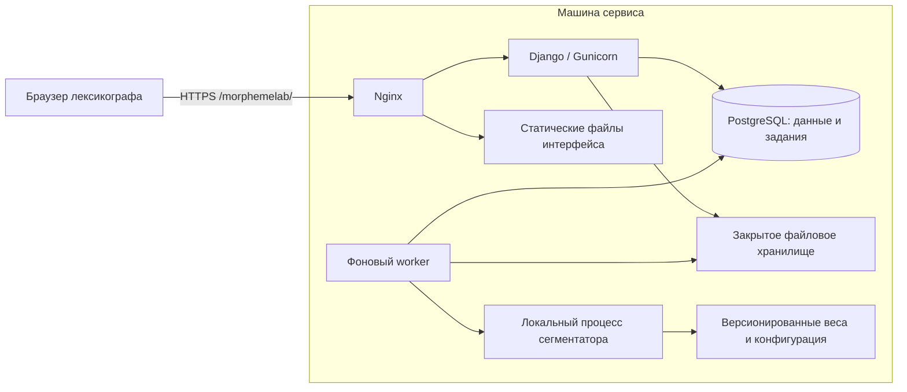

# Архитектура

Статус: предложение для первой версии, 2026-11-06.

## Общая схема

Приложение — модульный монолит: единый репозиторий, единая модель данных
и общие миграции. Веб-запросы и тяжёлые вычисления выполняются разными
процессами на одной машине. Такое разделение позволяет редактировать
разборы, пока модель обрабатывает файл, и ограничивает число копий модели
в памяти.

## Технологии и ответственность

| Компонент | Предложение | Основание |
| --- | --- | --- |
| Backend | Python, Django 5.2 LTS с актуальным исправлением безопасности | Авторизация, сессии, формы, ORM, миграции и административный интерфейс в одной системе |
| UI | Шаблоны Django и TypeScript для редактора; сборка Vite | Основные страницы просты; сложное взаимодействие сосредоточено в одном компоненте |
| База | PostgreSQL поддерживаемой версии, ориентир — 18 | Транзакции, ограничения целостности, JSONB и очередь в той же базе |
| HTTP | Gunicorn за существующим Nginx | Обычные короткие HTTP-запросы и один origin |
| Задания | Таблица `Job` и отдельная management command `runworker` | При малой нагрузке не нужен отдельный брокер сообщений |
| Модель | Адаптер и постоянный локальный дочерний процесс worker | Модель вне веб-процессов; отдельное окружение, тайм-аут и перезапуск |
| Файлы | Закрытые каталоги на диске, метаданные в PostgreSQL | Небольшой объём и одна машина; объектное хранилище пока избыточно |
| Развёртывание | Docker Compose, либо systemd при ограничениях машины | Набор процессов тот же; выбор упаковки после обследования сервера |

Это архитектурный выбор проекта, а не требование сегментатора. Версии Python,
ML-библиотек, размер батча и GPU определяются после знакомства с моделью.
Веб-окружение не обязано содержать зависимости модели. Django 5.2 имеет
заявленную расширенную поддержку до апреля 2028 года; точные версии
зависимостей следует закрепить при реализации.
[Официальный жизненный цикл Django](https://www.djangoproject.com/download/#supported-versions).

## Границы модулей

| Модуль | Что принадлежит модулю |
| --- | --- |
| `accounts` | Пользователи, приглашения, сессии, сброс пароля |
| `projects` | Проекты, участие и проверка доступа |
| `datasets` | Импорт, нормализация, исходные файлы, неизменяемые записи |
| `inference` | Реестр моделей, запуски, кандидаты, адаптер сегментатора |
| `annotations` | Наборы разметки, редактор, ревизии, проверка сегментов |
| `jobs` | Очередь, попытки, отмена и восстановление |
| `exports` | Фиксация снимка, JSONL/TSV, манифесты и скачивание |
| `evaluation` | Протоколы оценки и расчёты по фиксированным выгрузкам |

Модули — части одного приложения, не отдельные сетевые сервисы.
Бизнес-операции выполняются функциями сервисного слоя в транзакциях.
Проверка прав применяется до чтения и изменения объектов, включая фоновые
операции по запросам пользователей. Админка не заменяет интерфейс лексикографа.

## Путь входного файла

1. Web проверяет доступ и ограничения загрузки, пишет файл под случайным
   внутренним именем и рассчитывает SHA-256. Оригинальное имя — только метаданные.
2. В короткой транзакции создаёт `Import` и задание проверки. Файл уже должен
   быть атомарно помещён в постоянный каталог, прежде чем на него ссылается БД.
3. Worker потоково проверяет формат, кодировку, ограничения и строки.
   Ошибки представлены с номерами строк. Набор с ошибками не становится готовым.
4. Пользователь видит предварительный отчёт и подтверждает импорт.
   Проверенные записи публикуются как неизменяемый `Dataset`; промежуточные
   строки до этого не доступны для инференса.
5. Запуск фиксирует модель, конфигурацию и состав набора; задания создаются
   в той же транзакции, что и запуск. Worker берёт небольшие порции слов.
6. Каждый завершённый результат сохраняется с кандидатами и происхождением.
   Интерфейс опрашивает состояние раз в 1–2 секунды, пока есть активная работа,
   и реже в неактивной вкладке. WebSocket для первой версии не требуется.

Предлагаемые ограничения: файл до 10 MiB, до 100 000 строк, слово до 256
кодовых точек. Это эксплуатационные начальные значения, а не измеренная
ёмкость сервера. Лимит длины модели может быть строже.

## Путь правки и экспорта

Web загружает доступную пользователю запись, кандидаты закреплённого запуска
и текущую ревизию разметки. При сохранении проверяет права, версию и
инварианты сегментации. Новая ревизия и новый указатель на текущую ревизию
фиксируются одной транзакцией. Кандидаты модели не меняются.

Создание выгрузки сначала фиксирует список входных записей, ревизий
и результатов модели в согласованном снимке БД. Отдельное задание строит
файлы именно по этим идентификаторам; дальнейшая правка не меняет выгрузку.
Снимок строится в короткой транзакции с уровнем `REPEATABLE READ` либо одним
эквивалентным согласованным чтением. Нельзя последовательно читать изменяемые
«текущие ревизии» при построении большого файла.

## Очередь и восстановление

Очередь хранится в PostgreSQL. Доставка задания — как минимум однократная;
операции записи результата должны быть идемпотентными. Поддержка очередей
при помощи `FOR UPDATE SKIP LOCKED` описана в
[документации PostgreSQL](https://www.postgresql.org/docs/18/sql-select.html#SQL-FOR-UPDATE-SHARE).

Алгоритм worker:

1. В короткой транзакции выбирает готовый `Job`, выставляет `running`,
   новый `attempt_token` и срок аренды `lease_until`, затем завершает транзакцию.
2. Выполняет работу вне транзакции. Передаёт батч дочернему процессу модели;
   координатор продолжает обновлять аренду и следить за тайм-аутом.
3. При сохранении снова блокирует `Job`, проверяет токен попытки, срок аренды
   и отмену. Только действующий владелец записывает результаты и завершает
   задание; просроченная попытка не может перезаписать новую.
4. После истечения аренды другое выполнение получает новый токен. Уже
   зафиксированные `RunItem` не вычисляются повторно. Если вычисление было,
   но транзакция не сохранилась, допускается повторное вычисление.

Нельзя держать транзакцию и блокировку строк всё время работы модели.
Уникальные ограничения на результат слова и ранг кандидата защищают
от дублей. Повторная попытка не заменяет уже сохранённый успешный ответ.

При старте — один worker и одна модель в памяти. Задания инференса содержат
малые батчи; стартовый ориентир 32 слова проверяется измерением. Координатор
чередует запуски, а одиночным словам даёт ограниченный приоритет, чтобы
большой файл не задерживал их на всё время обработки. Текущий батч не
вытесняется. Импорт и экспорт получают время между батчами.

Состояния `Job`: `queued → running → succeeded`; временный сбой переводит
его в `queued` с задержкой, исчерпанные попытки — в `failed`. Начальное
предложение — максимум три попытки. Постоянные ошибки входа не повторяются.
`cancel_requested` — отдельный флаг; отмена завершается состоянием `cancelled`.
Результаты, сохранённые до отмены, остаются, незавершённые элементы отмечаются
отменёнными. Публикация следующего батча после подтверждённой отмены запрещена.

`InferenceRun` отдельно агрегирует состояния слов: `queued`, `running`,
`completed`, `completed_with_errors`, `failed`, `cancelled`.
`completed` означает успешный инференс, а не человеческую проверку.

## Поведение при сбоях

| Событие | Ожидаемое поведение |
| --- | --- |
| Закрыта вкладка | Задания продолжаются; сохранённые правки остаются |
| Повторён POST после обрыва связи | Ключ идемпотентности возвращает прежнюю операцию |
| Модель зависла или исчерпала память | Дочерний процесс останавливается, попытка отмечается; web продолжает обслуживать редактор |
| Worker завершился | После окончания аренды задания доступны повторно |
| Некорректный ответ на одно слово | У слова диагностическая ошибка, остальные результаты сохраняются |
| База недоступна | Сохранение не объявляется успешным; неопубликованный ответ модели можно вычислить заново |
| Два пользователя сохранили одновременно | Один получает конфликт версии; чужой результат не затирается |
| Заполнен диск | Новые загрузки/экспорты отклоняются, причина видна администратору |

Redis, Celery, отдельный API-сервис, Kubernetes и распределённый инференс
сейчас не требуются. Переход к зрелой внешней очереди имеет смысл при появлении
нескольких вычислительных узлов или сложного расписания; очередь в БД уже
требует полноценной реализации аренды, отмены и повторных попыток.
