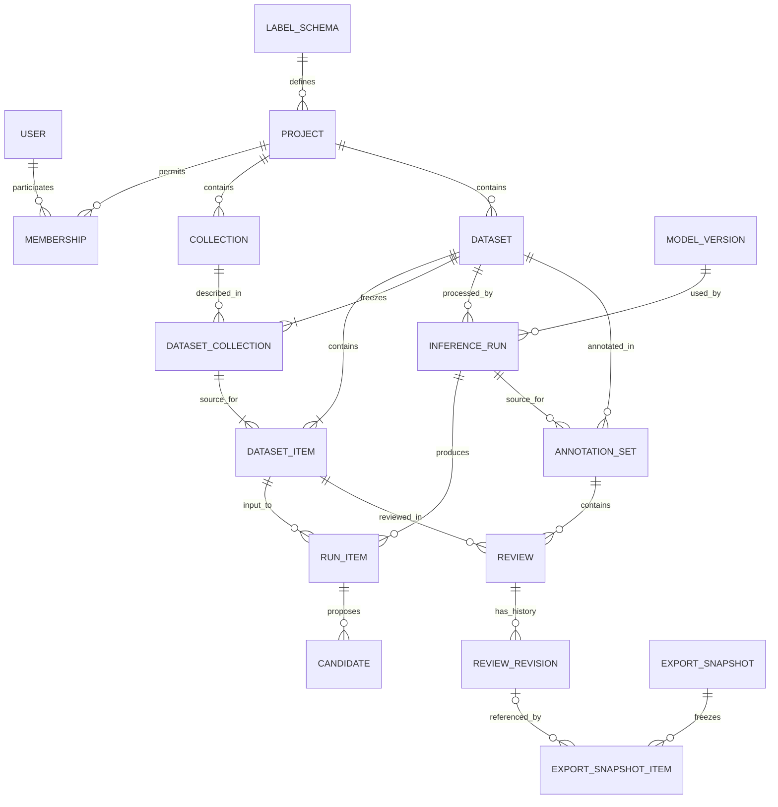

# Модель данных

Статус: логическая схема для реализации, 2026-11-06. Это ещё не миграции БД.
Идентификаторы предметных объектов — UUID; время хранится в UTC с часовым
поясом, интерфейс отображает его в выбранном часовом поясе пользователя.

## Основные сущности

| Сущность | Назначение и существенные поля |
| --- | --- |
| `User` | Аккаунт, имя входа, хеш пароля, активность; собственная модель пользователя Django с первой миграции |
| `Invitation` | Хеш токена, срок, создатель, проекты/роли, момент использования или отзыва |
| `Project` | Название, режим `dictionary/evaluation`, закреплённая `LabelSchema`, настройки доступа |
| `Membership` | Пользователь, проект, роль `manager/lexicographer` |
| `Collection` | Словарь: проект, название, необязательные `description` и `default_language`, `lock_version`, автор и время изменения, признак архивирования |
| `LabelSchema` | Неизменяемые версия, коды и описания типов морфем, разрешения нулевых морфем |
| `StoredFile` | Внутренний ключ, исходное имя, размер, SHA-256, назначение, создатель |
| `Import` | Проект, исходный файл, коллекция по умолчанию, снимки метаданных используемых коллекций, формат, версия парсера/нормализации, отчёт, состояние |
| `Dataset` | Проект, автор, импорт или одиночный ввод, имя, число записей, хеш упорядоченного содержимого, `canonical_annotation_set_id` для словаря |
| `DatasetCollection` | Снимок коллекции в наборе: `dataset_id`, `collection_id`, `collection_version`, название, описание и `default_language` на момент импорта |
| `DatasetItem` | Набор, коллекция, позиция, физическая строка файла, `external_id`, `word_original`, `word_normalized`, `language_override`, зафиксированные `language` и `language_source`, исходные метаданные |
| `ModelVersion` | Имя, версия, контрольные суммы весов/конфигурации, версия адаптера, окружение, поддерживаемые языки, возможности и разрешённые параметры |
| `InferenceRun` | Набор, модель, снимок эффективных параметров, seed, версия приложения, инициатор, времена и агрегированное состояние |
| `RunItem` | Запуск, входная запись, состояние, фактическая среда/попытка, время, диагностический код, исходный ответ адаптера |
| `Candidate` | Результат слова, исходный ранг, валидированные сегменты, необязательный score и его семантика |
| `AnnotationSet` | Набор, закреплённый запуск, вид `shared/independent`, назначенный пользователь, протокол показа кандидатов |
| `Review` | Набор разметки, входная запись, текущая ревизия, `lock_version` |
| `ReviewRevision` | Предыдущая ревизия, автор, время, статус, сегменты, комментарий, способ правки, исходный кандидат, ключ операции |
| `Job` | Тип работы, объект, порция записей, состояние, попытки, аренда, токен попытки, отмена и ошибка |
| `ExportSnapshot` | Тип выгрузки, фильтры, наборы/запуски, создатель, версия схемы, состояние и файлы |
| `ExportSnapshotItem` | Снимок, входная запись, набор разметки, конкретная ревизия или её отсутствие, выбранный результат инференса |
| `AuditEvent` | Кто, когда и над каким объектом выполнил значимое действие |

Частые фильтры и связи — отдельные типизированные столбцы. Массивы сегментов,
неизвестные заранее параметры модели и небольшие исходные ответы — JSONB
с обязательной серверной проверкой. Большие артефакты лежат в файловом
хранилище, а не в строках БД.

## Связи



Диаграмма показывает основные связи, а не все служебные поля и ограничения.

## Коллекция и язык записи

`Collection` задаёт словарь и его текущее описание; `Dataset` задаёт партию
обработки, которая может смешивать несколько коллекций. В первой версии
коллекции принадлежат проекту и используют его права доступа. Ссылка на
коллекцию другого проекта не принимается ни при импорте, ни при одиночном вводе.

`Collection.default_language` и `DatasetItem.language_override` необязательны.
Язык хранится строковым тегом из согласованного справочника, а не текстом
названия языка. Правила кодирования описаны в [форматах](data-formats.md).

При проверке импорта берётся снимок метаданных каждой используемой коллекции.
Для каждой записи вычисляется:

```text
language = language_override ?? collection_snapshot.default_language
```

`??` выбирает первое значение, отличное от `null`. `language_source` равен
`word`, если язык задан явно; `collection`, если он унаследован;
`unspecified`, если оба значения отсутствуют. Явное значение, совпадающее
с языком коллекции, всё равно имеет источник `word`.

Предпросмотр показывает эти снимки и результаты наследования. При подтверждении
импорта версии коллекций проверяются в одной транзакции с публикацией набора.
Если метаданные успели измениться, требуется обновить предпросмотр;
нельзя незаметно подставить другой язык. После подтверждения снимки сохраняются
в `DatasetCollection`, а `language` — в неизменяемой записи слова.
Поле снимка `collection_version` содержит `lock_version` исходной коллекции.

Изменение текущего описания или языка коллекции применяется к новым импортам.
Прошлые запуски и выгрузки используют снимки; актуальное описание можно
показывать отдельно с пометкой об изменении. Исправление принадлежности
или языка уже импортированного слова требует нового набора. В хеш входного
набора входят также идентификаторы/версии коллекций, явные и вычисленные
языки и их источники, а не только последовательность слов.

## Инварианты

1. `Membership(project_id, user_id)`, `DatasetItem(dataset_id, position)`,
   `RunItem(run_id, item_id)`, `Candidate(run_item_id, rank)` и
   `Review(annotation_set_id, item_id)` уникальны.
2. Непустой `external_id` уникален в пределах пары «набор, коллекция»;
   разные словари могут использовать одинаковые исходные идентификаторы.
   Текст слова, в том числе вместе с языком, не является уникальным ключом.
   Повторяющиеся словоформы сохраняются разными записями.
3. Готовые `DatasetItem`, `ModelVersion`, конфигурация запуска, кандидаты,
   ревизии и состав опубликованного снимка неизменяемы. Статусы исполнения
   и указатели на текущие редакции изменяемы по установленным переходам.
4. Набор, запуск и набор разметки принадлежат одному проекту и относятся
   к одному `Dataset`. Кандидат, используемый в ревизии, относится к тому же
   слову и закреплённому запуску `AnnotationSet`. Эти связи проверяются
   сервисным слоем в транзакции; где возможно — ограничениями БД.
5. `shared` имеет `assignee_id = null`, `independent` — конкретного пользователя.
   Частичные уникальные индексы обеспечивают один общий набор разметки на
   запуск и один независимый на пару «запуск, пользователь». Повторный
   эксперимент создаёт новый запуск, даже если модель та же.
6. В словарном наборе `canonical_annotation_set_id` указывает на общий набор
   разметки этого же материала. Новый инференс не меняет этот указатель.
   Смена текущей редакции — отдельное действие руководителя с аудитом.
7. Текущая ревизия принадлежит своему `Review`; номер версии монотонно растёт.
   Отсутствие ревизии означает `unreviewed` и не подменяется первым кандидатом.
8. Для `confirmed` сегментация полностью валидна. `skipped` имеет причину
   и `segments = null`. Черновик может содержать неполные метки, но не
   произвольные пересечения или изменение текста слова.
9. Для `accept_candidate` сегменты точно совпадают с выбранным кандидатом.
   `edit_candidate` хранит ссылку на исходный кандидат и изменённый разбор.
   `manual` не требует кандидата. Показ кандидатов фиксируется отдельно
   и не выводится из того, использовал ли человек кнопку выбора.
10. Удаление родительского объекта не каскадно уничтожает результаты
    эксперимента и ревизии. Обычная операция — архивирование; удаление файлов
    выполняется отдельно с проверкой ссылок и установленного срока хранения.
11. `DatasetCollection(dataset_id, collection_id)` уникален и содержит
    неизменяемый снимок. Каждая запись ссылается на одну из этих пар;
    проект коллекции совпадает с проектом набора. Коллекция не переносится
    между проектами обычным обновлением поля.
12. `language` и `language_source` соответствуют явному значению и снимку
    коллекции; они не вычисляются заново из текущих метаданных при чтении.
    Непустые языковые теги проверены по правилам формата; неуказанный язык
    не подменяется русским по умолчанию.

Для запросов нужны индексы по проекту, набору/позиции, запуску/статусу,
коллекции/языку записи, набору разметки/текущему статусу
и очереди `(state, available_at)`.
Точные индексы уточняются по запросам реализованного интерфейса.

## Транзакция сохранения

Клиент отправляет `base_version` и уникальный `operation_id`. Сервер находит
либо создаёт строку `Review` с учётом уникального ограничения и блокирует её.
Если версия отличается, возвращает `409 Conflict` без записи. Иначе создаёт
`ReviewRevision`, меняет указатель и увеличивает версию. Повтор той же операции
с тем же содержимым возвращает уже созданную ревизию; с другим — конфликт.

Восстановление старой редакции создаёт новую ревизию, поэтому сохраняется
история того, кто и когда принял решение. По умолчанию восстановленный вариант
становится черновиком и требует нового подтверждения.

## Происхождение результата

Для каждой подтверждённой записи можно установить:

- исходный файл, номер строки, идентификатор и текст до нормализации;
- коллекцию и снимок её описания/языка, явный язык слова и результат наследования;
- версию нормализации, словарь меток и точный текст, переданный адаптеру;
- версию весов, адаптера, кода и параметры запуска;
- исходные кандидаты модели и их порядок;
- протокол показа кандидатов, автора, способ правки и историю ревизий;
- точную ревизию, вошедшую в конкретную выгрузку.

`AuditEvent` фиксирует приглашения, смену ролей, запуск/отмену обработки,
экспорт, изменения метаданных коллекций, архивирование и смену канонической
редакции. Пароли, токены и полное
содержимое словарей в эксплуатационный журнал не пишутся. История разметки
хранится в предметных таблицах, а не восстанавливается из текстовых логов.
